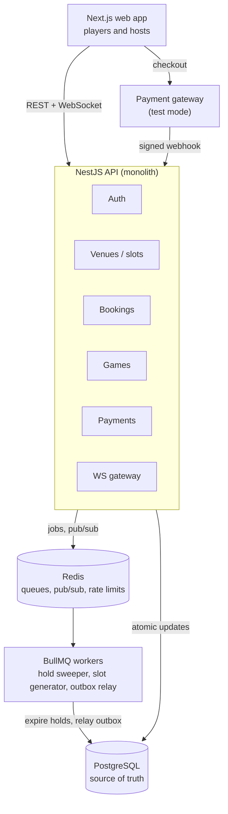
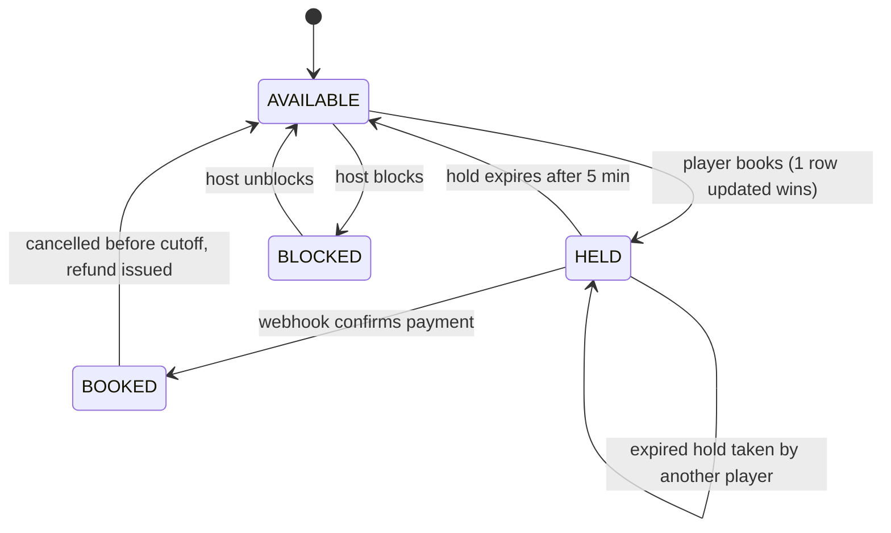

# DinkUp

**Book a pickleball court in Chandigarh tricity — or join an open game and split the cost. Two players can never win the same slot.**

DinkUp is a pickleball-only booking platform for Chandigarh, Mohali, Panchkula and Zirakpur. Hosts list venues and publish court availability; players book slots, or open the remaining seats of their booking so others at their level can join a doubles game.

Under the hood, every contested write (a slot, a seat, a payment confirmation) is settled atomically by PostgreSQL, and the guarantees are proven with race-condition tests and load tests rather than claimed.

> **Live demo:** `TODO: link` · **Test login:** `TODO` · **Test card:** see the payment gateway's test-mode docs

---

## Highlights

- **Zero double-bookings** — slot holds and seat claims are single conditional `UPDATE`s backed by unique and check constraints. Verified under `TODO: 500` concurrent requests (see [Load test results](#load-test-results)).
- **5-minute holds** — a slot is held while the player pays, then released automatically if they don't.
- **Open games** — book a court, open the remaining seats, and let players at your skill level join and pay their share.
- **Idempotent APIs** — double-clicks and network retries never create duplicate bookings or charges.
- **Webhook-confirmed payments** — signature-verified, deduplicated, with automatic refunds when a payment arrives after its hold expired and the slot was taken.
- **Live availability** — slots grey out on every open screen in real time over WebSockets.
- **Reliable notifications** — a transactional outbox ensures confirmation emails are never lost or sent for a rolled-back booking.

## Tech stack

| Layer    | Tools                                                                              |
| -------- | ---------------------------------------------------------------------------------- |
| Frontend | Next.js (App Router), TanStack Query, Socket.IO client, Tailwind CSS               |
| Backend  | NestJS, Prisma, PostgreSQL 16, Redis, BullMQ, Socket.IO                            |
| Payments | Razorpay (test mode)                                                               |
| Testing  | Jest, Testcontainers, k6                                                           |
| Infra    | Docker Compose (local), managed Postgres + Redis, S3-compatible storage for photos |

## Architecture



The browser only talks to the Nest API. Every booking decision is one row update in Postgres; Redis only moves work around (background jobs, live updates, rate limiting).

## How double-booking is prevented

### Holding a slot

A slot is never checked and then booked in two steps — that is exactly where races happen. Instead, one statement either wins the row or touches nothing:

```sql
UPDATE slots
SET status = 'HELD', held_by = $user,
    hold_expires_at = now() + interval '5 minutes',
    version = version + 1
WHERE id = $slot
  AND (status = 'AVAILABLE'
       OR (status = 'HELD' AND hold_expires_at < now()))
RETURNING id;
```

- **1 row returned** → the player holds the slot.
- **0 rows returned** → someone else got there first; the API returns `409` with the slot's current state.

**Why it's safe:** Postgres locks the row for the duration of the update. A second concurrent request waits, then re-evaluates the `WHERE` clause against the updated row, sees `HELD`, and updates nothing. As a safety net, a partial unique index allows at most one `PENDING` or `CONFIRMED` booking per slot.

### Claiming a seat in an open game

```sql
UPDATE games
SET seats_taken = seats_taken + 1
WHERE id = $game AND status = 'OPEN'
  AND seats_taken < seats_total
RETURNING seats_taken;
```

A `CHECK (seats_taken <= seats_total)` constraint backs it up, so a game can never be overfilled.

### Expiring holds

Correctness never depends on a background job: the `WHERE` clause already treats an expired hold as free. A BullMQ job runs every 30 seconds only to tidy up stale holds, expired bookings and released seats.

## Slot lifecycle



| Record    | States                                                                                       |
| --------- | -------------------------------------------------------------------------------------------- |
| Booking   | `PENDING` → `CONFIRMED` → `CANCELLED`, or `PENDING` → `EXPIRED` → `REFUNDED` |
| Game seat | `HELD` → `CONFIRMED` or `RELEASED`                                                    |
| Game      | `OPEN` → `FULL` or `CANCELLED`                                                        |
| Payment   | `CREATED` → `CAPTURED`, or `CAPTURED` → `REFUND_PENDING` → `REFUNDED`           |

## Idempotency

Every checkout attempt carries a client-generated UUID in an `Idempotency-Key` header (`POST /bookings`, `POST /games/:id/seats`, `POST /payments/orders`). A Nest interceptor records the key before the handler runs:

| Situation                        | Response                                         |
| -------------------------------- | ------------------------------------------------ |
| New key                          | Run the handler, store the response              |
| Key seen, request finished       | Replay the stored response — nothing runs twice |
| Key seen, still in progress      | `409`, retry shortly                           |
| Key reused with a different body | `422`                                          |
| Handler failed with a 5xx        | Key deleted so a genuine retry can run           |

Keys expire after 24 hours.

## Payments

The webhook, not the browser, is the source of truth.

1. After a hold, the API creates a gateway order.
2. The browser opens checkout; on success it shows "Confirming…" and waits on the WebSocket.
3. The webhook arrives: the HMAC signature is verified and the event ID is inserted into `webhook_events` (`ON CONFLICT DO NOTHING`), so duplicate deliveries are ignored.
4. In one transaction, the slot moves `HELD → BOOKED` only if the hold still belongs to that player, the booking is confirmed, and an outbox row is written for the confirmation email.

**Late-payment edge case:** if the payment lands after the hold expired *and* another player has taken the slot, step 4 updates zero rows. The payment is marked `REFUND_PENDING`, a refund is issued through the gateway, and the player is notified. If the hold expired but nobody else took the slot, the booking is still honoured.

## Getting started

### Prerequisites

- Node.js 20+ and pnpm
- Docker and Docker Compose
- A Razorpay account in test mode (for payment flows)

### Setup

```bash
git clone https://github.com/arora001/backend-dinkup
cd backend-dinkup
pnpm install

# Start Postgres and Redis
docker compose up -d

# Configure environment
cp apps/api/.env.example apps/api/.env
cp apps/web/.env.example apps/web/.env.local

# Apply migrations (includes hand-written SQL for partial indexes and check constraints)
pnpm --filter api prisma migrate dev

# Seed demo venues, courts and slots
pnpm --filter api seed

# Run API and web app
pnpm dev
```

The web app runs on `http://localhost:3000` and the API on `http://localhost:4000`.

### Environment variables (API)

| Variable                                                             | Purpose                       |
| -------------------------------------------------------------------- | ----------------------------- |
| `DATABASE_URL`                                                     | PostgreSQL connection string  |
| `REDIS_URL`                                                        | Redis connection string       |
| `JWT_SECRET`                                                       | Signing key for access tokens |
| `RAZORPAY_KEY_ID`, `RAZORPAY_KEY_SECRET`                         | Gateway test-mode credentials |
| `RAZORPAY_WEBHOOK_SECRET`                                          | Verifies webhook signatures   |
| `S3_ENDPOINT`, `S3_BUCKET`, `S3_ACCESS_KEY`, `S3_SECRET_KEY` | Venue photo storage           |
| `EMAIL_API_KEY`                                                    | Transactional email provider  |

## Testing

```bash
# Unit tests
pnpm --filter api test

# Race-condition integration tests (spins up a real Postgres via Testcontainers)
pnpm --filter api test:race

# Load tests (requires k6 and a running API)
k6 run load-tests/one-slot-race.js
k6 run load-tests/browse-and-book.js
```

The race tests assert, against a real database:

- 50 parallel bookings on one slot → exactly 1 succeeds, 49 receive `409`.
- 20 parallel seat claims on a game with 3 open seats → exactly 3 succeed.
- The same idempotency key sent 10 times in parallel → 1 booking.
- The same webhook delivered 5 times → 1 confirmation, 1 email.
- A late webhook after the slot was re-taken → refund issued, no double-booking.

## Load test results

> Fill in after running k6 against the staging deployment.

| Scenario                               | Concurrent users | Confirmed bookings | p95 latency | Error rate |
| -------------------------------------- | ---------------- | ------------------ | ----------- | ---------- |
| All users race for one slot            | TODO             | TODO (expected: 1) | TODO        | TODO       |
| Browse and book across 50 slots, 2 min | TODO             | TODO               | TODO        | TODO       |

`TODO: add a GIF of two browsers racing for the same slot`

## API overview

| Method and path                                           | Who     | Purpose                           |
| --------------------------------------------------------- | ------- | --------------------------------- |
| `POST /auth/signup`, `POST /auth/login`, `GET /me`  | All     | Authentication                    |
| `POST /venues`, `PATCH /venues/:id`                   | Host    | Create and edit venues            |
| `GET /venues?area=&date=`                               | Public  | Browse venues                     |
| `POST /venues/:id/courts`, `PUT /courts/:id/schedule` | Host    | Courts and weekly schedules       |
| `GET /courts/:id/slots?date=`                           | Public  | Slots for a day, with live status |
| `POST /slots/:id/block`                                 | Host    | Block a slot for maintenance      |
| `POST /bookings` *(idempotent)*                       | Player  | Hold a slot                       |
| `POST /bookings/:id/cancel`                             | Player  | Cancel before cutoff              |
| `POST /bookings/:id/game`                               | Player  | Open remaining seats              |
| `GET /games?area=&date=&level=`                         | Public  | Open Games feed                   |
| `POST /games/:id/seats` *(idempotent)*                | Player  | Claim a seat                      |
| `POST /payments/orders` *(idempotent)*                | Player  | Create a gateway order            |
| `POST /payments/webhook`                                | Gateway | Confirm payments                  |
| `WS /realtime`                                          | All     | Live slot and seat updates        |

## Project structure

```
dinkup/
├── apps/
│   ├── api/                 # NestJS backend
│   │   ├── prisma/          # schema, migrations (incl. raw SQL), seed
│   │   └── src/
│   │       ├── auth/
│   │       ├── venues/      # venues, courts, schedules, slots
│   │       ├── bookings/
│   │       ├── games/
│   │       ├── payments/    # orders, webhooks, refunds
│   │       ├── realtime/    # WebSocket gateway
│   │       ├── jobs/        # BullMQ workers: sweeper, slot generator, outbox relay
│   │       └── common/      # idempotency interceptor, guards, throttling
│   └── web/                 # Next.js frontend
├── load-tests/              # k6 scripts
└── docker-compose.yml
```

## Roadmap

- [ ] Variable-length bookings (60 / 90 min) using a Postgres exclusion constraint on time ranges
- [ ] Skill ratings that update after games
- [ ] WhatsApp notifications
- [ ] Waitlist that auto-assigns a freed slot to the next player in line

## Author

**Arsh Arora** — `TODO: GitHub / LinkedIn`

## License

MIT
